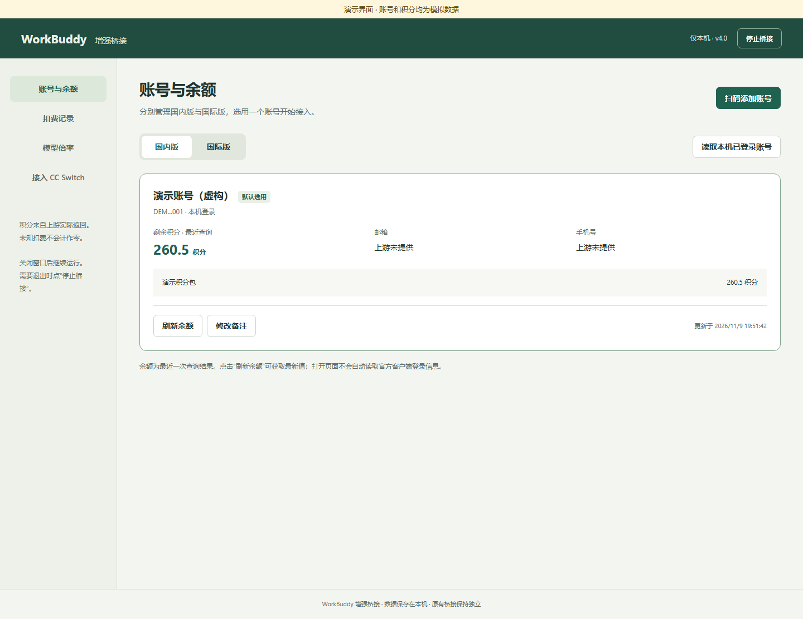
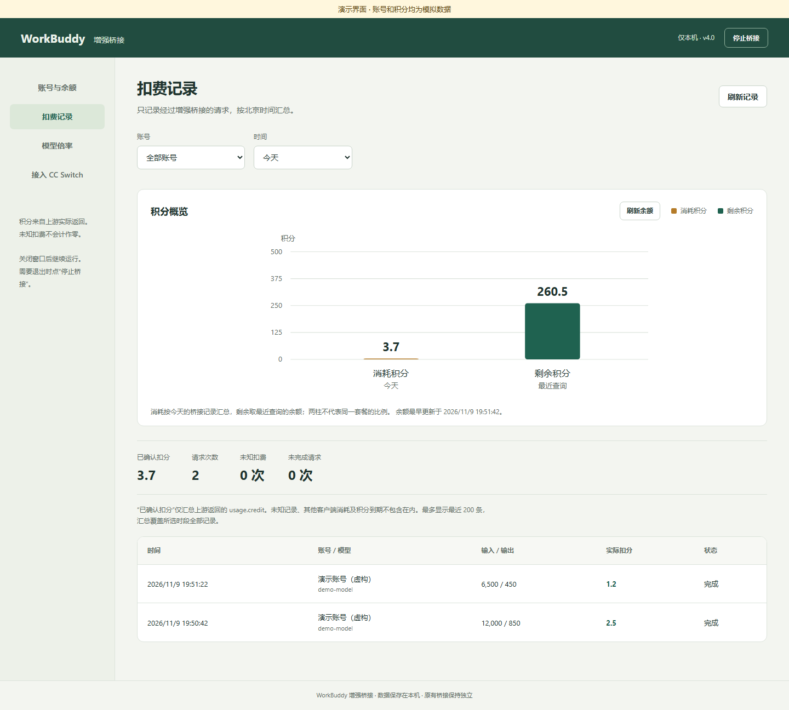

# codex桥接workbuddy · A 版直连傻瓜包

把本人已登录的 WorkBuddy 账号直接接入 Codex，不需要 CC Switch。管理页点一下“选用账号”，下一条 Codex 消息就换国内 / 国际账号。

[](https://github.com/hcycyxx/codex-workbuddy-bridge/releases/latest)
[](#运行条件)
[](LICENSE)

> 发布后下载：`v5.0.0-direct` Release 中的安装 EXE、便携 ZIP、源码与中文文档 ZIP。

## 适用对象

- 没装 CC Switch，或不想让 Codex 再经过 `15721` 代理。
- 只想第一次一键连接，以后靠管理页换号。
- 已装 CC Switch 且使用聚合模式：请改用 B 版 `v5.0.0-ccswitch`。

## 功能

- 国内版 / 国际版账号分开管理，支持官方授权页扫码与读取本机已登录账号。
- 查询剩余积分、记录每次请求上游返回的实际扣分、查看动态模型倍率。
- 一键备份并写入用户级 `~/.codex/config.toml`，接口固定到 `http://127.0.0.1:8900/v1`。
- 以后切换账号不用改 Codex 配置、不用重启 Codex；进行中的请求仍归原账号。

## 界面预览

以下沿用 v4 已发布的真实界面截图，**账号和积分均为标明的演示数据**，不是 A 版一键连接的实测截图。





## 运行条件

- Windows 10 / 11；Codex 桌面版或 CLI。
- Node.js 22 或更新版本、Chrome、Windows 自带 .NET Framework。
- 使用自己的 WorkBuddy 账号；安装程序不内置 Node.js、Chrome 或账号。

## 安装和启动

1. 下载 `v5.0.0-direct` 安装 EXE，确认目录后点击安装并创建桌面图标；或使用便携包。
2. 双击桌面图标打开管理页，添加或读取 WorkBuddy 账号，点“选用账号”。
3. 双击“一键连接Codex.cmd”。它会备份 `config.toml`，写入桥接地址、provider 和环境变量名称，并在 `backups/` 生成本机密钥指引文件。
4. 按提示设置用户环境变量 `WB_BRIDGE_API_KEY`，**完全退出并重新打开 Codex 一次**。
5. 新建对话发一句话，再到“扣费记录”核对账号和扣分。以后换号只在管理页点“选用账号”。

默认管理页：`http://127.0.0.1:8900`。关闭窗口后桥接继续运行；停止请点页面右上角“停止桥接”。

## 一键连接做了什么

只改用户级 `~/.codex/config.toml`，写入一个名为 `workbuddy_direct` 的自定义 provider：

```toml
model = "hy4free"
model_provider = "workbuddy_direct"
[model_providers.workbuddy_direct]
name = "WorkBuddy Direct"
base_url = "http://127.0.0.1:8900/v1"
wire_api = "responses"
env_key = "WB_BRIDGE_API_KEY"
```

不改 `auth.json`，不删除旧 provider，不改项目级配置，不设置开机自启。首次重启 Codex 后，账号选择由 `8900` 桥接每次请求现场读取，所以能点一下换号。官方配置规则见 [OpenAI Docs：Advanced Configuration](https://learn.chatgpt.com/docs/config-file/config-advanced)。

## 回退

把 `backups/codex-config-*.toml` 拖到“还原Codex配置.cmd”，然后完全退出并重新打开 Codex。也可运行：

```powershell
node tools\setup-codex-direct.mjs --restore --backup <备份文件>
```

## 数据、更新与卸载

- `data/` 保存本机加密账号库、扣费记录和余额查询记录；不要上传或分享。
- `backups/` 保存配置备份和密钥指引；密钥指引只在本机使用。
- 更新时先停止旧版，再将旧版 `data` 完整复制到新版目录；同一 Windows 用户才能解开 DPAPI 保护的账号库。
- 卸载前先回退 `config.toml`，停止桥接，删除程序目录和桌面快捷方式。

## 开发与验证

```powershell
npm run check
npm test
powershell -NoProfile -ExecutionPolicy Bypass -File .\desktop\Build-v4.ps1
node scripts\prepare-release.js
```

本版已做静态检查、现有测试、EXE 编译、打包清单与哈希核对；未在本机执行一键连接、未重启 Codex、未做真实付费模型调用或跨机安装验收。上述实际运行效果留给用户测试。

## 风险与限制

- 依赖 WorkBuddy 非公开接口，上游调整时可能需要适配；请自行评估账号风险，仅使用自己的账号。
- A 版与仍接管 `config.toml` 的 CC Switch 互斥；若 CC Switch 会把地址写回 `15721`，请停用接管或改用 B 版。
- 模型与账号需匹配；换区后建议新开对话测试一次。

<!-- jack-white-rice-support:start -->
## 请大肥鱼吃大白饭 🍚

如果这个项目帮到了你，欢迎请大肥鱼吃一碗大白饭。自愿投喂，量力而行，感谢支持！

<p>
  <a href="assets/support/alipay-jack-v1.jpg"></a>
  <a href="assets/support/rice-meme-v1.png"></a>
</p>
<!-- jack-white-rice-support:end -->

## 许可

MIT，见 [LICENSE](LICENSE)。
